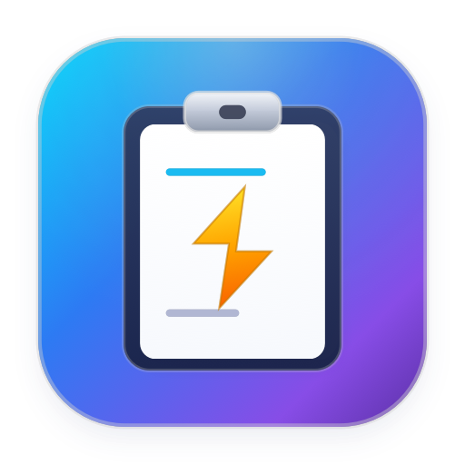

<p align="center">
  
</p>

<h1 align="center">SuperClip</h1>

<p align="center">
  <strong>Ultra-lightweight, Lightning-Fast Native macOS Clipboard Manager</strong><br>
  <em>Swift &bull; SwiftUI &bull; Direct Auto-Paste &bull; Universal 2 &bull; Multi-language Support</em>
</p>

<p align="center">
  <a href="#english">English</a> &bull; <a href="#tiếng-việt">Tiếng Việt</a>
</p>

<p align="center">
  <a href="https://github.com/nhanqv-ai/SuperClip/releases"></a>
  <a href="LICENSE"></a>
  
  
  
</p>

---

<a name="english"></a>
## English

**SuperClip** is an ultra-lightweight, native macOS menu bar clipboard manager built with Swift and SwiftUI. It seamlessly monitors clipboard history, provides instant search, supports pinning and masking sensitive clips, and offers instant selection with **Direct Auto-Paste** (Windows `Win + V` style) via both a menu bar popover and a global floating panel.

### Highlights

- **Direct Auto-Paste (Windows Win+V Style)**: Selecting a clip via click, Enter, or number keys (`1..9`) automatically pastes the content directly into the previously focused application/input field without requiring an extra manual `Cmd + V`. Graceful fallback to clipboard copy if Accessibility permissions are not granted.
- **Circular Keyboard Arrow Navigation**:
  - Automatically pre-selects the first item upon opening and whenever search queries change.
  - Pressing `Up Arrow` at the top wraps around to the last item.
  - Pressing `Down Arrow` at the bottom wraps around to the first item.
- **Sensitive Information Masking**: One-click toggle (`eye.slash` / `eye`) on row hover or right-click context menu to conceal sensitive text (passwords, tokens, API keys) as `••••••••` on screen and in hover previews, while still allowing seamless unmasked paste into destination fields.
- **Ignored Applications Filtering**: Exclude specific applications (such as password managers or sensitive editors) from history recording by bundle identifier or name.
- **Ultra-Compact Single-Line Design**: Every clip is presented on a clean, single line with tail truncation, fitting 15-20 clips into view without scrolling, plus hover thumbnail/preview panel.
- **Dual Presentation**:
  - **Menu Bar Popover**: Click the status item in the menu bar to review recent clips.
  - **Global Floating Panel**: Press customizable global hotkey (default: `Option + Space` or `Option + V`) anywhere on macOS to summon a floating panel centered near your mouse cursor.
- **Universal 2 Architecture**: Compiled as a native fat Mach-O binary supporting both Apple Silicon (`arm64`: M1/M2/M3/M4) and Intel (`x86_64`: MacBook Pro 2020 and earlier) on macOS 13.0 (Ventura) and macOS 14.6+ (Sonoma).
- **Automatic Update Checker**: Seamlessly checks GitHub Releases for new updates in the background with an in-app banner and one-click update/restart.
- **Launch at Login**: Native startup management using modern macOS `SMAppService`.
- **Text & Image Clip Support**: Captures both plain text and copied images with dimensions (`[Image] 1920x1080` / `[Ảnh] 1920x1080`).
- **Instant Search**: Real-time filtering across both pinned and recent items with diacritic-insensitive matching.
- **Multi-Language Support**: Full dynamic runtime translation without restarting: English, Vietnamese (Tiếng Việt), Simplified Chinese (简体中文), Japanese (日本語), Korean (한국어), Spanish (Español), French (Français), German (Deutsch), and System Default.
- **Zero Emojis Invariant**: Flat, elegant typography and SF Symbols for a distraction-free professional interface.

### Keyboard Shortcuts

| Shortcut | Action | Scope |
| :--- | :--- | :--- |
| `Option + Space` / `Option + V` | Summon Floating Panel at cursor position (customizable) | Global |
| `1` .. `9` or `Cmd + 1` .. `Cmd + 9` | Directly select & auto-paste item 1 to 9 | Inside Panel |
| `Up / Down Arrow` | Circular navigation (wraps top to bottom & bottom to top) | Inside Panel |
| `Return / Enter` | Direct auto-paste selected item and dismiss | Inside Panel |
| `Escape` | Dismiss clipboard panel | Inside Panel |
| `Command + ,` | Open Preferences window | Inside Panel / Menu |
| `Command + Q` | Quit SuperClip | Inside Panel / Menu |
| `Right-Click / Hover` | Pin/Unpin, Mask/Reveal, Copy, Delete clip | Clip Row |

### System Requirements

- macOS 13.0 (Ventura), macOS 14.6+ (Sonoma), or newer
- Apple Silicon Mac (`arm64`) or Intel Mac (`x86_64`, e.g. MacBook Pro 2020)

### Installation

#### Pre-built Release
1. Download the latest `SuperClip-v1.0.6.zip` from [Releases](https://github.com/nhanqv-ai/SuperClip/releases).
2. Unzip and drag `SuperClip.app` into your `/Applications` folder.
3. Open `SuperClip.app`. An icon will appear on your macOS menu bar.

> [!NOTE]
> **First-Time Launch (macOS Gatekeeper)**:
> Since SuperClip is an independent open-source project without Apple Developer ID notarization, macOS may show a verification dialog (*"SuperClip" Not Opened*). You can allow it via any of these methods:
> - **Terminal (Recommended)**: Run `xattr -cr /Applications/SuperClip.app` (or on the unzipped path).
> - **System Settings**: Go to **System Settings** -> **Privacy & Security** -> click **Open Anyway**.
> - **Finder**: Right-click `SuperClip.app` -> choose **Open** -> click **Open**.

> [!TIP]
> **Accessibility Permission (Direct Auto-Paste & TCC Cache Refresh)**:
> Direct auto-paste simulates `Cmd + V` into your target application, which requires macOS Accessibility permission.
> - **Quick Setup**: In SuperClip **Preferences** -> **General** -> **Options**, click **Grant Permission...**.
> - **macOS Sonoma / Ventura Cache Fix**: If SuperClip was previously installed and System Settings retains a stale cache, click "Grant Permission..." in SuperClip (which flushes stale TCC entries), or open **System Settings** -> **Privacy & Security** -> **Accessibility**, select `SuperClip`, click the minus (`-`) button to remove the old entry, then grant permission again.
> - **Terminal Shortcut**: You can also run `tccutil reset Accessibility com.superclip.SuperClip` to instantly clear stale permission cache.

#### Build from Source
```bash
git clone https://github.com/nhanqv-ai/SuperClip.git
cd SuperClip
make app
open SuperClip.app
```

### Development & Testing

```bash
# Compile and run complete test suite (1,790+ tests, 100% pass)
make test

# Run adversarial concurrency & high-throughput stress test suite (78 challenges)
make adversarial

# Verify standalone Universal 2 app bundle integrity
make verify-app

# Check strict 0-emoji invariant
make lint

# Package distributable Universal 2 zip archive
make package

# Clean build artifacts
make clean
```

### License

This project is licensed under the MIT License - see the [LICENSE](LICENSE) file for details.

---

<a name="tiếng-việt"></a>
## Tiếng Việt

**SuperClip** là ứng dụng quản lý lịch sử clipboard siêu nhẹ, native cho macOS được xây dựng hoàn toàn bằng Swift và SwiftUI. Ứng dụng tự động theo dõi nội dung sao chép, hỗ trợ tìm kiếm tức thì, ghim và ẩn thông tin nhạy cảm, tích hợp tính năng **Tự động dán trực tiếp** (Direct Auto-Paste giống Windows `Win + V`) qua cả thanh Menu Bar và cửa sổ nổi (floating panel) gọi bằng phím tắt toàn cục.

### Tính năng nổi bật

- **Tự động dán trực tiếp (Direct Auto-Paste giống Windows Win+V)**: Khi chọn một mục (bằng chuột, phím Enter hoặc phím số `1..9`), nội dung sẽ được tự động dán thẳng vào ô nhập liệu đang focus của ứng dụng trước đó mà không cần bấm thêm `Cmd + V`. Tự động chuyển về chế độ chỉ copy an toàn nếu chưa cấp quyền Trợ năng.
- **Điều hướng phím mũi tên xoay vòng (Circular Arrow Navigation)**:
  - Tự động chọn sẵn mục đầu tiên khi mở clipboard và khi lọc kết quả tìm kiếm.
  - Nhấn `Mũi tên Lên` tại mục đầu tiên sẽ nhảy xuống mục cuối cùng.
  - Nhấn `Mũi tên Xuống` tại mục cuối cùng sẽ nhảy lên mục đầu tiên.
- **Ẩn / Hiện thông tin nhạy cảm (Sensitive Info Masking)**: Nút bật/tắt nhanh (`eye.slash` / `eye`) khi rê chuột hoặc trong menu chuột phải giúp che mật khẩu, token, khóa API dưới dạng `••••••••` trên màn hình và trong cửa sổ xem trước, nhưng vẫn dán đúng nội dung gốc khi sử dụng.
- **Bỏ qua ứng dụng nhạy cảm (Ignored Apps)**: Cấu hình danh sách ứng dụng cần bỏ qua (như 1Password, Bitwarden...) để không ghi lại lịch sử khi sao chép từ các ứng dụng này.
- **Giao diện một dòng siêu gọn gàng**: Mỗi mục hiển thị trên đúng một dòng với dấu chấm lửng (`...`), hiển thị được 15-20 mục trong tầm nhìn mà không cần cuộn chuột, kèm panel xem trước hình ảnh/văn bản khi rê chuột.
- **Hai chế độ hiển thị linh hoạt**:
  - **Menu Bar Popover**: Nhấn vào icon trên thanh menu để xem danh sách clipboard.
  - **Cửa sổ nổi toàn cục (Floating Panel)**: Nhấn phím tắt toàn cục (mặc định: `Option + Space` hoặc `Option + V`) ở bất kỳ ứng dụng nào để mở cửa sổ chọn nhanh ngay tại vị trí con trỏ chuột.
- **Kiến trúc Universal 2**: Biên dịch dưới dạng Mach-O fat binary hỗ trợ gốc cả chip Apple Silicon (`arm64`: M1/M2/M3/M4) và chip Intel (`x86_64`: MacBook Pro 2020 và các đời Intel) trên macOS 13.0 (Ventura) và macOS 14.6+ (Sonoma).
- **Tự động kiểm tra bản cập nhật**: Chạy ngầm định kỳ kiểm tra bản mới từ GitHub Releases, hiển thị thông báo tinh tế và cập nhật/khởi động lại chỉ với 1 click.
- **Khởi động cùng hệ thống**: Tích hợp chuẩn `SMAppService` hiện đại của macOS.
- **Hỗ trợ văn bản và hình ảnh**: Ghi nhận cả văn bản thuần và ảnh chụp màn hình kèm thông số kích thước (`[Ảnh] 1920x1080`).
- **Tìm kiếm tức thì**: Lọc kết quả real-time theo nội dung, không phân biệt dấu tiếng Việt.
- **Hỗ trợ đa ngôn ngữ**: Thay đổi ngôn ngữ tức thì trong cài đặt: Tiếng Việt, Tiếng Anh, Tiếng Trung, Tiếng Nhật, Tiếng Hàn, Tiếng Tây Ban Nha, Tiếng Pháp, Tiếng Đức và Mặc định hệ thống.
- **Quy chuẩn 0 Emojis**: Sử dụng font chữ tiêu chuẩn và icon SF Symbols hiện đại, tinh tế, tối giản cho môi trường làm việc chuyên nghiệp.

### Bảng phím tắt thông dụng

| Phím tắt | Thao tác | Phạm vi |
| :--- | :--- | :--- |
| `Option + Space` / `Option + V` | Mở cửa sổ nổi chọn clipboard tại vị trí chuột (tùy chỉnh được) | Toàn hệ thống |
| `1` .. `9` hoặc `Cmd + 1` .. `Cmd + 9` | Chọn và tự động dán nhanh mục từ 1 đến 9 | Trong cửa sổ |
| `Mũi tên Lên / Xuống` | Điều hướng xoay vòng (đầu vòng xuống cuối, cuối vòng lên đầu) | Trong cửa sổ |
| `Return / Enter` | Tự động dán mục đang chọn và đóng cửa sổ | Trong cửa sổ |
| `Escape` | Đóng cửa sổ clipboard | Trong cửa sổ |
| `Command + ,` | Mở cửa sổ Cài đặt (Preferences) | Trong cửa sổ / Menu |
| `Command + Q` | Thoát ứng dụng SuperClip | Trong cửa sổ / Menu |
| `Chuột phải / Rê chuột` | Ghim, Ẩn/Hiện thông tin nhạy cảm, Sao chép, Xóa mục | Từng dòng clip |

### Yêu cầu hệ thống

- macOS 13.0 (Ventura), macOS 14.6+ (Sonoma) trở lên
- Hỗ trợ tốt trên chip Apple Silicon (`arm64`) và chip Intel (`x86_64`, ví dụ MacBook Pro 2020)

### Hướng dẫn cài đặt

#### Tải bản đóng gói sẵn
1. Tải bản phát hành mới nhất `SuperClip-v1.0.6.zip` tại mục [Releases](https://github.com/nhanqv-ai/SuperClip/releases).
2. Giải nén và kéo file `SuperClip.app` vào thư mục `/Applications` (Ứng dụng).
3. Mở `SuperClip.app`. Biểu tượng ứng dụng sẽ xuất hiện trên thanh menu macOS.

> [!NOTE]
> **Mở ứng dụng lần đầu (macOS Gatekeeper)**:
> Do SuperClip là phần mềm mã nguồn mở độc lập (chưa đăng ký chứng chỉ Apple Developer có phí), macOS có thể hiển thị thông báo bảo vệ (*"SuperClip" Not Opened*). Bạn có thể mở ứng dụng dễ dàng bằng một trong các cách:
> - **Dùng Terminal (Nhanh nhất)**: Chạy lệnh `xattr -cr /Applications/SuperClip.app` (hoặc đường dẫn file vừa giải nén).
> - **Dùng Cài đặt hệ thống**: Vào **System Settings** -> **Privacy & Security** -> cuộn xuống mục **Security** -> chọn **Open Anyway** (Vẫn mở).
> - **Dùng chuột phải**: Nhấp chuột phải (hoặc giữ phím `Control` + click) vào `SuperClip.app` -> chọn **Open** (Mở) -> chọn **Open**.

> [!TIP]
> **Cấp quyền Trợ năng (Tự động dán - Direct Auto-Paste & Làm mới cache TCC)**:
> Tính năng tự động dán mô phỏng thao tác `Cmd + V` vào ô nhập liệu nên cần quyền Trợ năng (Accessibility) của macOS.
> - **Cấp quyền nhanh**: Vào SuperClip **Cài đặt** -> tab **Chung** -> mục **Tùy chọn** -> bấm **Cấp quyền...**.
> - **Xử lý kẹt cache trên macOS Sonoma / Ventura**: Nếu trước đó bạn đã cài phiên bản cũ và Cài đặt hệ thống lưu cache TCC cũ, hãy bấm nút "Cấp quyền..." trong SuperClip (sẽ tự động dọn sạch cache kẹt), hoặc vào **Cài đặt hệ thống** -> **Quyền riêng tư & Bảo mật** -> **Trợ năng**, chọn mục `SuperClip` và nhấn nút dấu trừ (`-`) để xóa mục cũ, sau đó cấp quyền lại.
> - **Lệnh Terminal tiện lợi**: Bạn cũng có thể chạy lệnh `tccutil reset Accessibility com.superclip.SuperClip` để dọn sạch cache kẹt ngay lập tức.

#### Biên dịch từ mã nguồn
```bash
git clone https://github.com/nhanqv-ai/SuperClip.git
cd SuperClip
make app
open SuperClip.app
```

### Lệnh phát triển & Kiểm thử

```bash
# Chạy bộ kiểm thử tự động toàn diện (1.790+ bài test, pass 100%)
make test

# Chạy bộ kiểm thử tải cao và chịu lỗi concurrency (78 kịch bản)
make adversarial

# Xác thực tính toàn vẹn của bundle ứng dụng Universal 2
make verify-app

# Kiểm tra quy chuẩn nghiêm ngặt 0-emoji
make lint

# Đóng gói file nén zip phân phối Universal 2
make package

# Dọn dẹp file build
make clean
```

### Giấy phép (License)

Dự án được phân phối dưới giấy phép [MIT License](LICENSE).
